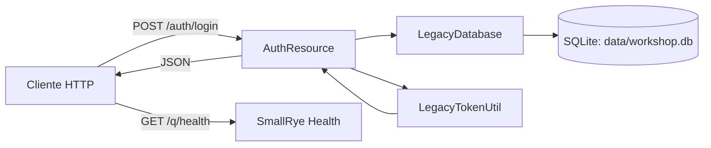

# Summary
- Proyecto backend Java orientado a autenticación de usuarios de laboratorio.
- Implementado con Quarkus y construido con Maven.
- Expone un endpoint principal de login y un endpoint de salud provisto por Quarkus.
- Persiste usuarios en una base SQLite local para uso de taller.

# Contexto del proyecto
- Tipo de proyecto: API REST en Java.
- Stack principal:
  - Java 21.
  - Quarkus 3.27.4.
  - Maven.
  - SQLite JDBC.
- Objetivo funcional:
  - Validar credenciales de usuarios de laboratorio.
  - Retornar un token y datos básicos del usuario autenticado.
- Componentes de código relevantes:
  - `AuthResource` para exponer la API de autenticación.
  - `LegacyDatabase` para inicialización y consulta de usuarios.
  - `LegacyTokenUtil` para construcción del token.
  - `LoginRequest` y `UserRecord` como modelos de entrada/salida.

# Diagrama de componentes
- Flujo principal de autenticación:
  - Cliente HTTP invoca `POST /auth/login`.
  - `AuthResource` valida request y delega búsqueda de usuario a `LegacyDatabase`.
  - `LegacyDatabase` consulta SQLite local.
  - `AuthResource` genera token con `LegacyTokenUtil` y responde JSON.
- Diagrama:


# Arquitectura del proyecto
- Arquitectura por capas simples:
  - Capa de entrada REST:
    - `AuthResource` recibe JSON, valida campos y construye respuestas HTTP.
  - Capa de acceso a datos:
    - `LegacyDatabase` crea estructura inicial y ejecuta consulta por credenciales.
  - Capa utilitaria:
    - `LegacyTokenUtil` arma el valor del token.
  - Capa de modelos:
    - `LoginRequest` para request de login.
    - `UserRecord` para datos del usuario recuperado.
- Configuración:
  - Puerto y host en `application.properties`.
  - CORS habilitado por configuración de Quarkus.

# Apis implementadas, inputs y outputs
- `POST /auth/login`
  - Input:
    - Body JSON con `username` (requerido), `password` (requerido), `client` (opcional).
  - Output 200:
    - `token`: string.
    - `expiresIn`: number.
    - `user`: objeto con `username`, `displayName`, `role`.
    - `debug`: string.
  - Output 400:
    - JSON con `message` cuando faltan datos del request.
  - Output 401:
    - JSON con `message` para credenciales inválidas.
  - Output 500:
    - JSON con `message` y `exception` ante error no controlado.
- `GET /q/health`
  - Input:
    - Sin body.
  - Output:
    - JSON de estado de salud generado por SmallRye Health.

# Ejemplos de uso
- API: `POST /auth/login`
  - Request:
```json
{
  "username": "student",
  "password": "Workshop123!",
  "client": "angular-workshop"
}
```
  - Response 200:
```json
{
  "token": "BASE64_TOKEN_EXAMPLE",
  "expiresIn": 3600,
  "user": {
    "username": "student",
    "displayName": "Workshop Student",
    "role": "STUDENT"
  },
  "debug": "authenticated-with-legacy-flow"
}
```
  - Response 401:
```json
{
  "message": "Invalid user student or password"
}
```
- API: `GET /q/health`
  - Request:
```json
{}
```
  - Response:
```json
{
  "status": "UP",
  "checks": []
}
```
